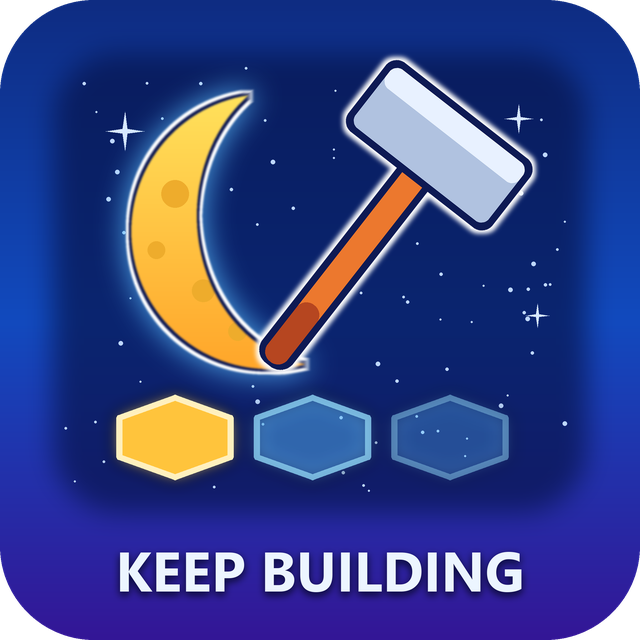

<div align="center">



# KeepBuilding

**Place the same building again and again: a Moon Sweepers mod**

[](https://github.com/Yukitus86/MoonSweepers-KeepBuilding/releases/latest)
[](https://github.com/Yukitus86/MoonSweepers-KeepBuilding/releases)
[](#compatibility)
[](#linux--steam-deck-proton)
[](LICENSE)

[**Download**](https://github.com/Yukitus86/MoonSweepers-KeepBuilding/releases/latest) ·
[Installation](#installation) ·
[Configuration](#configuration) ·
[Troubleshooting](#troubleshooting) ·
[Report a bug](https://github.com/Yukitus86/MoonSweepers-KeepBuilding/issues/new/choose)

</div>

---

In vanilla Moon Sweepers **the hammer forgets your selection after every placement**, so you reopen the build menu for
each copy. With **KeepBuilding** the building stays selected, with its rotation, until you pick something else or
cancel.

## Features

| | |
|---|---|
| 🔨 **Selection stays** | Place, move on, place again. The menu stays closed |
| 🔄 **Rotation stays** | The ghost keeps its rotation and free-placement mode |
| 🛡️ **Same rules as always** | Every spot is checked again and every building costs its normal price |
| 🏭 **Machines too** | Machines stay selected instead of switching to the conveyor tool (configurable) |
| 📦 **No mod loader** | One DLL. No BepInEx or MelonLoader needed |
| 🤝 **Plays nice** | Works next to [NoFocusLoss](https://github.com/Yukitus86/MoonSweepers-NoFocusLoss) |
| 🧹 **Clean uninstall** | Delete two files and the game is vanilla again |

To stop building, use the normal cancel key or switch tools.

## Installation

1. **Download** `KeepBuilding-MoonSweepers-vX.Y.Z.zip` from the
   [latest release](https://github.com/Yukitus86/MoonSweepers-KeepBuilding/releases/latest).
2. **Open the game folder.** In Steam, right-click **Moon Sweepers**, then choose **Manage** → **Browse local files**.
3. **Extract** `dwmapi.dll` and `KeepBuilding.ini` into that folder, next to `MoonSweepers.exe`:

   ```text
   Moon Sweepers\
   ├── MoonSweepers.exe
   ├── UnityPlayer.dll
   ├── dwmapi.dll          ◄ from the mod
   ├── KeepBuilding.ini   ◄ from the mod
   └── ...
   ```

4. **Start the game** through Steam as usual.

> [!TIP]
> Default game folder: `C:\Program Files (x86)\Steam\steamapps\common\Moon Sweepers`

### Verify

After starting the game, `KeepBuilding.log` appears in the game folder:

```text
KeepBuilding 1.0.0 loaded. Enabled=1 ConveyorAfterMachine=0
Caught il2cpp_init.
Hook installed (MachineBuilt at ...).
```

Place a building and this line is added:

```text
Building placed, selection kept.
```

### Uninstall

Delete `dwmapi.dll`, `KeepBuilding.ini` and `KeepBuilding.log` from the game folder.

## Configuration

Edit `KeepBuilding.ini` in the game folder (`1` = on, `0` = off). Changes apply the next time you place something.

| Setting | Default | Description |
|---|:---:|---|
| `Enabled` | `1` | Turns the mod on or off. A game started with `0` needs a restart to turn it on. |
| `ConveyorAfterMachine` | `0` | In vanilla, machines with conveyor ports switch to the conveyor tool after placing. `0` keeps the machine selected, `1` switches like vanilla. |
| `Log` | `1` | Writes `KeepBuilding.log` to the game folder. Read when the game starts. |

## Compatibility

| Platform | Status |
|---|---|
| Windows 11 x64 | ✅ Tested |
| Windows 10 x64 | ⚠️ Untested, should work |
| Linux / Steam Deck (Proton) | ⚠️ Untested ([see below](#linux--steam-deck-proton)) |

| | |
|---|---|
| Game build | Steam release with Unity `6000.6.0f1` (IL2CPP, metadata v108) |
| Multiplayer | Untested |

### Linux / Steam Deck (Proton)

Untested. Proton uses its own `dwmapi.dll` unless you tell it to load the game's copy. Install the files as above,
then set this in Steam → Moon Sweepers → **Properties** → **Launch Options**:

```text
WINEDLLOVERRIDES="dwmapi=n,b" %command%
```

If you try this, please report back in an [issue](https://github.com/Yukitus86/MoonSweepers-KeepBuilding/issues).

## Troubleshooting

<details>
<summary><b>No <code>KeepBuilding.log</code> appears</b></summary>

- Make sure `dwmapi.dll` is directly next to `MoonSweepers.exe` and not in a subfolder.
- Make sure `Log=1` is set in `KeepBuilding.ini`.
- On Linux/Proton, set the launch option shown above.

</details>

<details>
<summary><b>The ghost turns red right after placing</b></summary>

That's expected. The ghost is still standing where the new building is, so that spot is taken. Move or turn it and it
checks the new spot.

</details>

<details>
<summary><b>I want the conveyor tool after placing a machine</b></summary>

Set `ConveyorAfterMachine=1` in `KeepBuilding.ini`.

</details>

<details>
<summary><b>The log says <code>game updated?</code></b></summary>

A game update changed the builder code. The mod switches itself off and the game runs as vanilla. Open an
[issue](https://github.com/Yukitus86/MoonSweepers-KeepBuilding/issues/new/choose) and attach your
`KeepBuilding.log`.

</details>

<details>
<summary><b>Another mod also uses <code>dwmapi.dll</code></b></summary>

Only one `dwmapi.dll` can be in the game folder, so the two mods can't run together.

</details>

<details>
<summary><b>My antivirus flags <code>dwmapi.dll</code></b></summary>

DLL proxies sometimes trigger heuristic false positives. Release builds come straight from the public source through
[GitHub Actions](https://github.com/Yukitus86/MoonSweepers-KeepBuilding/actions), so you can read the code or
[build it yourself](#building-from-source).

</details>

## FAQ

**Can I get banned?**
The mod changes how the build tool behaves in memory on your own PC. It doesn't touch game files or saves, and Moon
Sweepers has no anti-cheat. As with any mod, use it at your own risk.

**Does it make building cheaper or skip the placement rules?**
No. The game checks every spot and charges every building exactly as it does in vanilla.

**Why `dwmapi.dll`?**
Unity's `UnityPlayer.dll` loads `dwmapi.dll`, and Windows checks the game folder first. The mod passes every real
`dwmapi.dll` function through to `C:\Windows\System32\dwmapi.dll`, so nothing breaks. Many mods and mod loaders use
this "DLL proxy" technique. NoFocusLoss already uses `version.dll`, so this mod takes a different name to run next to
it.

**Why not BepInEx?**
Moon Sweepers uses Unity 6000.6 with IL2CPP metadata v108, which BepInEx doesn't officially support yet. A native DLL
works whatever the IL2CPP version.

## How it works

```text
MoonSweepers.exe
 └─ UnityPlayer.dll ──loads──► dwmapi.dll (KeepBuilding)
                                 ├─ forwards real API ──► System32\dwmapi.dll
                                 ├─ catches il2cpp_init through UnityPlayer's GetProcAddress import
                                 └─ hooks MoonDepotBuilder.MachineBuilt in GameAssembly.dll
```

1. **The vanilla behaviour.** After each successful build the game calls `MoonDepotBuilder.MachineBuilt`, which ends
   the placement (`CancelPlacement`) or, for machines with conveyor ports, switches to the conveyor tool. Foundation
   modules skip that call and take a "keep placing" branch instead.
2. **The hook.** Game code calls `MachineBuilt` directly, so the mod finds it through the IL2CPP API and patches its
   first instructions with a jump. Field offsets and the method address are looked up by name at startup.
3. **Keep placing.** The hook gives every other building the foundation treatment: it ends any machine snap, drops the
   old placement checks and ignores the rest of the click. The game then checks the spot again with the new building
   on it, so nothing can be built twice in the same place.
4. **Safety.** If a game update changes a name or the start of the function, the mod logs it and leaves the game
   vanilla instead of patching blindly.

## Building from source

**Requirements:** Visual Studio 2022 or newer, with the **Desktop development with C++** workload.

```bat
git clone https://github.com/Yukitus86/MoonSweepers-KeepBuilding.git
cd MoonSweepers-KeepBuilding
build.bat
```

The output goes to `dist\`. Every push is built by GitHub Actions, and pushing a `v*` tag publishes a release
automatically.

<details>
<summary>Project layout</summary>

```text
src/KeepBuilding.c        mod source (hook, keep-placing logic, startup)
src/KeepBuilding.rc       version resource
src/dwmapi.def             export list of the proxy DLL (generated)
src/dwmapi_thunks.asm      forwarding stubs (generated)
src/dwmapi_exports.h       export table (generated)
tools/gen_dwmapi_proxy.py  generates the three files above from dumpbin /exports
KeepBuilding.ini          default config
build.bat                  build script (finds Visual Studio automatically)
.github/workflows/         CI build + automated releases
```

</details>

## License

Released under the [MIT License](LICENSE).

<sub>Not affiliated with or endorsed by the developers of Moon Sweepers.</sub>
